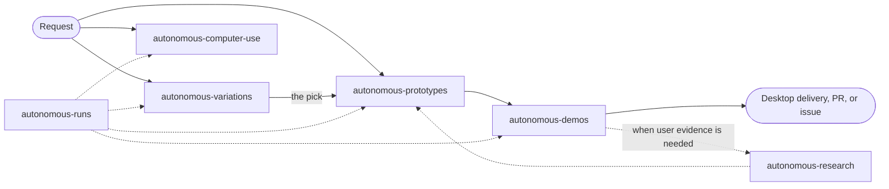

# Autonomous output skills

Agent skills for the work I hand to Copilot and walk away from: background desktop automation,
recording demos of the real product, building and shipping UI prototypes, running variation labs to
pick from, running user research, and working unattended for hours across a Mac and dev boxes.
Each skill encodes the rules I kept repeating to sessions, so the next run gets them right the first
time and the output needs no fixing.

## Skills

**Autonomous work**

| Skill | What it does | Triggers |
|-------|--------------|----------|
| [`autonomous-computer-use`](autonomous-computer-use/SKILL.md) | Background-only desktop app automation with a private virtual input lane, WorkIQ and Slack first, safe targeting, and exactly-once send verification; on Windows also build, launch, UI automation, and evidence, natively or in a UTM VM | "open Notes", "send in Slack", "use Computer Use", "check it on Windows" |
| [`autonomous-demos`](autonomous-demos/SKILL.md) | Videos, screenshot sets, before/after pairs, storyboards, and PR media from the real product, with the standing demo rules, an off-screen recording toolkit, QA, and Desktop delivery | "record a demo", "take screenshots", "before and after", "storyboard" |
| [`autonomous-prototypes`](autonomous-prototypes/SKILL.md) | Build and iterate UI in Code OSS, the website, and codicons; open one OSS window for live review; draft PRs with media, reviewers, green checks, and resolved Copilot comments | "branch off main and build", "open OSS", "draft PR", "fix the checks" |
| [`autonomous-variations`](autonomous-variations/SKILL.md) | Variation labs: exactly N genuinely different takes on one decision in real context, finished at every size and with reduced motion, rounds on named winners, the pick ported verbatim, and one page to review every lab | "make N variations", "explore options", "pick one and port it" |
| [`autonomous-runs`](autonomous-runs/SKILL.md) | Overnight and unattended operating rules (a live status list, never blocking on me, no corner-cutting, new sessions on the top model, handoffs, parallel agents, sharing the machine) and the hard-won gotchas by topic: Code OSS, recording, Computer Use, study platforms, evidence, GitHub media, labs, dev boxes | "work overnight", "I'm going to bed", "you have 8 hours", "make another session" |

**Shared**

| Skill | What it does | Triggers |
|-------|--------------|----------|
| [`my-voice`](my-voice/SKILL.md) | Writes anything I send or post as me (Slack and Teams messages, updates, feedback requests, PR text, notes, UI copy), kept current from my own edits and approvals | "write it like how I would say it", "make it sound like me" |

**Research, when a decision needs evidence from users**

| Skill | What it does | Triggers |
|-------|--------------|----------|
| [`autonomous-research`](autonomous-research/SKILL.md) | Studies (UserTesting and Outset, User Interviews recruiting, fraud-resistant screeners, launch only on my okay), synthesis (readouts, quote pulls, slideshows, decision digests, findings into an issue), and the Outset, Marvin, and User Interviews plumbing | "run a user test", "set up an Outset study", "analyze these studies", "what was decided" |



## Demo rules

[`DEMO-RULES.md`](DEMO-RULES.md) is the full list of rules for every demo, compiled from the
feedback across the September 24 to October 9, 2026 demo sessions. The short version:

1. Real product UI only, never mocked or painted over.
2. Never an error, warning, toast, or sign-in prompt on screen. Fix the setup and retake.
3. One story told through outcomes, the full flow from a clean start.
4. The full relevant window, at most two focal areas, file explorer and side panel closed.
5. Modern UI, compact, new session composer layout, Dark 2026, one theme for every asset.
6. A visible pointer with deliberate clicks and a subtle blue click ring; no random zooms.
7. One continuous take, idle waits fast-forwarded in place, key moments held long enough to read.
8. Watched end to end before delivery; delivered to a Desktop folder with a short `Read me.txt`.
9. Never steal focus, never touch other agents' windows, never need me mid-run, never cut corners.

## Variation labs

[`autonomous-variations`](autonomous-variations/SKILL.md) holds the rules for "make N variations",
compiled from the parallel design labs of October 9 to 12, 2026. The short version:

1. One lab per decision, shown in real context, with only the decision changing.
2. Exactly the count asked for, genuinely different ideas, plus today's version as `?v=0`.
3. The same conventions in every lab: `?v=`, `[` and `]`, a switcher pill, `?motion=off`, `?embed=1`,
   a manifest and stills.
4. Finished at desktop, tablet, phone and with reduced motion; checked headlessly; contact sheets
   looked at before anything is reported.
5. Real content only, and my visual and copy rules pasted into every lab brief.
6. Rounds build on the winners I name; earlier rounds stay reachable.
7. The pick ports verbatim from its commit with a sync script; copies are never edited by hand.
8. Many labs at once get one review page that ends in a prompt naming each pick.
9. Labs across dev boxes run on their own: the hub (orchestrator, file drop, review) is a dev box, so
   closing the laptop never stalls a session.

## How the skills stay current

Copilot CLI and VS Code (Insiders and the Agents window) load skills from `~/.copilot/skills` on each
machine, so whatever is installed there is live for every new session on that machine. Sessions also
improve skills while they work, in the installed copies and in the clone.

**Two repos.** A private repo has everything: the skills, the tools, and a `private/` folder that is
never published (machine setup scripts, the private terms the validator blocks, edits rescued from
retired skills). This public repo gets the same tree without `private/`, one reviewed commit at a
time. Teammates can push here; the next publish merges their commits into the private repo first.
On each machine the clone, `~/.copilot/autonomous-output-skills`, has the private repo as `origin`
and this one as `public`. The private URL has its own credential helper (GitHub CLI's token for the
account that owns it), so `public` keeps GitHub CLI's default account and git never prompts.

**One sync on every machine.** [`tools/sync-skills.py`](tools/sync-skills.py) `sync` runs once a day
and at logon: Task Scheduler on Windows (below-normal priority, no window), launchd on macOS
(background priority, low-priority I/O, Nice 10). The time comes from the private repo:
`private/sync-schedule.txt` has one rule per machine (daily at 10:30 without that file). Every sync
reads it, so a change there reaches each machine at its next run with nobody visiting the machine, and
each machine records what it applied in `private/machines/<host>.txt`. When nothing changed a run
exits within a few seconds,
after one `git ls-remote` and a fingerprint check. Otherwise it:

1. pulls the private main;
2. harvests edits sessions made to the installed copies (3-way merges against exactly what it
   installed, so nothing is overwritten) and commits them, with any other edits in the clone, as
   "Sync from <host>: <skills>";
3. blocks anything that looks like a secret;
4. rebases onto the private main and pushes; a conflict goes to a branch `conflict/<host>/<time>`
   instead, and that skill stays as it is installed until the branch is merged;
5. installs, with backups, and removes the skills named in [`retired.txt`](retired.txt) after saving
   any edits found in them under `private/rescued/<host>/`.

Only skills that exist in the repo are managed; other skills in `~/.copilot/skills` are left alone.
Each run appends one line, with its duration, to `~/.copilot/skills-sync.log`; `sync-skills.py
sync-status` shows the settings, the schedule, and the last runs.

**My messages in one place.** Once a day the sync also exports the messages I typed to agents on that
machine to `private/inbox/<host>/<yyyy-mm-dd>.jsonl` in the private repo: only what
[`tools/collect-messages.py`](tools/collect-messages.py) classifies as mine, never agent briefs,
automations, or autopilot continuations. Lines the secret scan flags are dropped, and only the last 14
days stay in the tree. A brief one agent sends to another session reads like something I typed, so
each machine also saves fingerprints (SHA-256, no text) of what its agents sent in
`private/inbox-sent/<host>/`, and every export removes rows that match any machine's fingerprints.
There are no model calls; `"inbox": false` in `~/.copilot/skills-sync.json` turns it off. For a longer
window, once, `sync-skills.py backfill-inbox --since <ISO time>` writes the same rows to
`private/inbox-backfill/<host>/<yyyy-mm>.jsonl` with a `manifest.json` (window, counts, checksums); the
14-day pruning leaves that folder alone, so delete it once it has been read.

**Publishing.** [`tools/publish-public.py`](tools/publish-public.py) merges `public/main` into the
private main, builds the publish tree (the private main without `private/` and the paths
`.publishignore` lists), checks it with the validator and the private terms, and pushes it here as
one new commit on top of `public/main`. Private history never comes here. `--dry-run` lists what
would change and pushes nothing.

**The weekly skill miner.** [`automations/weekly-skill-miner.md`](automations/weekly-skill-miner.md)
harvests, mines the week's messages from every machine (the inbox above) for repeated asks,
corrections, praise, design feedback, and writing voice, updates the skills (including `my-voice`),
validates, pushes to the private repo, and publishes. It runs on Mondays at 11:00 in the background
with Copilot CLI, on one machine only:
[`automations/run-weekly-skill-miner.py`](automations/run-weekly-skill-miner.py) schedules it with
Task Scheduler on Windows and [`automations/run-weekly-skill-miner.sh`](automations/run-weekly-skill-miner.sh)
with launchd on macOS (`--install` once; `--status`, `--check`, `--rehearse`, `--now`, and
`--uninstall` after that). Its state (the ledger, private notes, and writing samples in
`~/.copilot/skill-miner/`) goes to the private repo's `private/skill-miner/` with each sync and comes
back on every other machine, so any machine can take it over and `my-voice` has the samples
everywhere. Nothing in `private/` is ever published.

**Copilot CLI at the top settings.** The first sync on a machine also sets Copilot CLI's user
defaults (`~/.copilot/settings.json`) to Claude Opus 5.5 at max effort with the long context, with
every built-in sub-agent inheriting them, so a `copilot` run started with no flags, and its
sub-agents, use the top settings. It does this once and keeps the old values: `sync-skills.py
cli-defaults --undo` puts them back, and `"cli_defaults": false` in `~/.copilot/skills-sync.json`
skips it. The VS Code agent host does not read these while it runs
([`dev-boxes.md`](autonomous-runs/references/dev-boxes.md), "Checking and setting model, effort and
context").

The tools:

- [`tools/sync-skills.py`](tools/sync-skills.py): `sync`, `setup`, `schedule`, and `sync-status`,
  plus the steps on their own: `status` shows the differences, `harvest` brings installed edits into
  the clone, `resolve` marks a conflict merged by hand, and `install` backs up and copies.
- [`tools/publish-public.py`](tools/publish-public.py): the publish step above.
- [`tools/validate-skills.py`](tools/validate-skills.py): the checks every change has to pass,
  including the private terms. `private/` and `.publishignore` paths get only the secret and script
  checks; `--secrets-only` is the quick check the sync runs before every push.
- [`tools/collect-messages.py`](tools/collect-messages.py): gathers my own messages from
  `~/.copilot/session-state` and separates them from agent briefs (including text another session
  sent, matched by fingerprint), automations, and autopilot continuations; `--from-inbox` reads every
  machine's daily exports instead.
- [`tools/install-devbox.mjs`](tools/install-devbox.mjs): for a machine that only uses the published
  skills: it pulls this repo and installs them, and never publishes anything.

## Add a machine

It needs git, Python 3.8 or newer, and GitHub CLI signed in to both accounts: the default account,
which can push here, and the account that owns the private repo (`gh auth login` once for each). One
command per OS clones this repo if needed, points the clone at both repos, runs the first sync
(harvest first, then install), and schedules it. The exact commands for this setup, with the private
repo's URL and account filled in, are in `private/README.md` in the private repo.

macOS or Linux:

```bash
R=~/.copilot/autonomous-output-skills; [ -d "$R/.git" ] || git clone -q https://github.com/eli-w-king/autonomous-output-skills.git "$R"; python3 "$R/tools/sync-skills.py" setup --private-url <private repo URL> --private-user <account> && python3 "$R/tools/sync-skills.py" sync && python3 "$R/tools/sync-skills.py" schedule
```

Windows (PowerShell):

```powershell
$r = "$HOME\.copilot\autonomous-output-skills"; if (!(Test-Path "$r\.git")) { git clone -q https://github.com/eli-w-king/autonomous-output-skills.git $r }; python "$r\tools\sync-skills.py" setup --private-url <private repo URL> --private-user <account>; if ($?) { python "$r\tools\sync-skills.py" sync; python "$r\tools\sync-skills.py" schedule }
```

Then start a new agent session. See [INSTALL.md](INSTALL.md) for prerequisites, checks, and the
research keys.

## Publish

```bash
python3 ~/.copilot/autonomous-output-skills/tools/publish-public.py --dry-run   # what would change
python3 ~/.copilot/autonomous-output-skills/tools/publish-public.py             # publish it
```

On Windows, run the same script with `python`. The weekly miner publishes after each update; run it
by hand to publish sooner. It refuses when the validator finds a problem, when
`private/private-terms.txt` is missing, when the clone has work the sync has not pushed yet, or while
`private/publish-hold.txt` exists in the private repo (its first line says why; the weekly miner then
pushes to the private repo only, and dry runs still work). Delete that file to publish again.

## Renamed and merged skills

| Before | Now |
|--------|-----|
| `autonomous-long-runs`, `autonomous-skill-glossary` | `autonomous-runs` (the gotchas are in its `references/`, by topic) |
| `autonomous-user-studies`, `autonomous-research-synthesis`, `research-platforms` | `autonomous-research` (`references/running-a-study.md`, `synthesis.md`, `platforms.md`) |
| `automation-windows-os` | `autonomous-computer-use` (`references/windows.md`) |
| `autonomous-design-build-record-demo-unmoderated-research` (October 2026) | `autonomous-research` (capture and recording are in `autonomous-demos`) |
| `autonomous-research-synthesis-telemetry-iterative-design-issues` (October 2026) | `autonomous-research` |

The sync backs up and removes every old name from `~/.copilot/skills` on each machine
([`retired.txt`](retired.txt)).

## Contents

```text
DEMO-RULES.md              the demo rules, with sources
my-voice/                  SKILL.md (private writing samples stay in ~/.copilot/skill-miner/)
autonomous-demos/          SKILL.md, references/ (brief template, storyboards), scripts/
autonomous-computer-use/   SKILL.md, references/ (macos, windows)
autonomous-prototypes/     SKILL.md, references/ (design taste)
autonomous-variations/     SKILL.md, references/ (lab brief template, review page, distributed labs), scripts/
autonomous-runs/           SKILL.md, references/ (code-oss, recording, computer-use, studies, evidence,
                           machine-sharing, github-posts, labs-and-pages, dev-boxes)
autonomous-research/       SKILL.md, references/ (running-a-study, synthesis, harvest, platforms,
                           demo-video-capture, packaging), scripts/, chatmodes/, research.env.template
tools/                     sync-skills.py, publish-public.py, validate-skills.py, collect-messages.py, install-devbox.mjs
automations/               weekly-skill-miner.md (prompt and procedure), run-weekly-skill-miner.sh (schedule)
retired.txt                skill names the sync removes from every machine
docs/                      "Designing the Loop" talk site (GitHub Pages, July 2026)
INSTALL.md
```

The private repo also has `private/`, which is never published.

The `docs/` site is the July 2026 "Designing the Loop" talk about the original research loop,
kept as is for reference.
