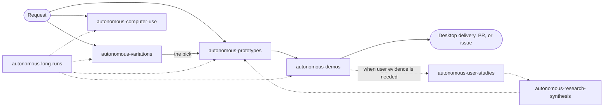

# Autonomous output skills

Agent skills for the work I hand to Copilot and walk away from: background desktop automation,
recording demos of the real product, building and shipping UI prototypes, running variation labs to
pick from, and working unattended for hours on a shared Mac.
Each skill encodes the rules I kept repeating to sessions, so the next run gets them right the first
time and the output needs no fixing.

## Skills

**Autonomous work**

| Skill | What it does | Triggers |
|-------|--------------|----------|
| [`autonomous-computer-use`](autonomous-computer-use/SKILL.md) | Background-only macOS app automation with a private virtual input lane, one-time permission setup, safe targeting, and exactly-once send verification | "open Notes", "send in Slack", "use Computer Use", any native desktop-app action |
| [`autonomous-demos`](autonomous-demos/SKILL.md) | Videos, screenshot sets, before/after pairs, storyboards, and PR media from the real product, with the standing demo rules, an off-screen recording toolkit, QA, and Desktop delivery | "record a demo", "take screenshots", "before and after", "storyboard" |
| [`autonomous-prototypes`](autonomous-prototypes/SKILL.md) | Build and iterate UI in Code OSS, the website, and codicons; open one OSS window for live review; draft PRs with media, reviewers, green checks, and resolved Copilot comments | "branch off main and build", "open OSS", "draft PR", "fix the checks" |
| [`autonomous-variations`](autonomous-variations/SKILL.md) | Variation labs: exactly N genuinely different takes on one decision in real context, finished at every size and with reduced motion, rounds on named winners, the pick ported verbatim, and one page to review every lab | "make N variations", "explore options", "pick one and port it" |
| [`autonomous-long-runs`](autonomous-long-runs/SKILL.md) | Overnight and unattended operating rules: a live status list, never blocking on me, no corner-cutting, handoffs, parallel agents, shared-Mac etiquette | "work overnight", "I'm going to bed", "you have 8 hours" |

**Shared**

| Skill | What it does | Triggers |
|-------|--------------|----------|
| [`my-voice`](my-voice/SKILL.md) | Writes anything I send or post as me (Slack and Teams messages, updates, feedback requests, PR text, notes, UI copy), kept current from my own edits and approvals | "write it like how I would say it", "make it sound like me" |
| [`autonomous-skill-glossary`](autonomous-skill-glossary/SKILL.md) | Hard-won gotchas plus topic references for Computer Use, Code OSS, recording, and study platforms | read by the other skills |
| [`automation-windows-os`](automation-windows-os/SKILL.md) | Optional Windows execution and validation, natively or through a UTM VM | "check it on Windows" |

**Research, when a decision needs evidence from users**

| Skill | What it does | Triggers |
|-------|--------------|----------|
| [`autonomous-user-studies`](autonomous-user-studies/SKILL.md) | UserTesting and Outset studies, User Interviews recruiting, fraud-resistant screeners, launch only on my okay | "run a user test", "set up an Outset study" |
| [`autonomous-research-synthesis`](autonomous-research-synthesis/SKILL.md) | Readouts, quote pulls, slideshows, decision digests of issue threads, and findings into an issue | "analyze these studies", "what was decided" |
| [`research-platforms`](research-platforms/SKILL.md) | Outset, Marvin, and User Interviews plumbing: auth, client, results watcher, API gotchas | read by the study skills |



## Demo rules

[`DEMO-RULES.md`](DEMO-RULES.md) is the full list of rules for every demo, compiled from the
feedback across the September 24 to October 9, 2026 demo sessions. The short version:

1. Real product UI only, never mocked or painted over.
2. Never an error, warning, toast, or sign-in prompt on screen. Fix the setup and retake.
3. One story told through outcomes, the full flow from a clean start.
4. The full relevant window, at most two focal areas, file explorer and side panel closed.
5. Modern UI, compact, new session composer layout, Dark 2026, one theme for every asset.
6. A visible pointer with deliberate clicks and a subtle blue click ring; no random zooms.
7. One continuous take, idle waits fast-forwarded in place, key moments held long enough to read.
8. Watched end to end before delivery; delivered to a Desktop folder with a short `Read me.txt`.
9. Never steal focus, never touch other agents' windows, never need me mid-run, never cut corners.

## Variation labs

[`autonomous-variations`](autonomous-variations/SKILL.md) holds the rules for "make N variations",
compiled from the parallel design labs of October 9 to 12, 2026. The short version:

1. One lab per decision, shown in real context, with only the decision changing.
2. Exactly the count asked for, genuinely different ideas, plus today's version as `?v=0`.
3. The same conventions in every lab: `?v=`, `[` and `]`, a switcher pill, `?motion=off`, `?embed=1`,
   a manifest and stills.
4. Finished at desktop, tablet, phone and with reduced motion; checked headlessly; contact sheets
   looked at before anything is reported.
5. Real content only, and my visual and copy rules pasted into every lab brief.
6. Rounds build on the winners I name; earlier rounds stay reachable.
7. The pick ports verbatim from its commit with a sync script; copies are never edited by hand.
8. Many labs at once get one review page that ends in a prompt naming each pick.

## How the skills stay current

Copilot CLI and VS Code (Insiders and the Agents window) both load skills from `~/.copilot/skills`,
so whatever is installed there is live in both for every new session. Nothing needs to be pulled for
Insiders.

Sessions also improve skills while they work, sometimes in this repo and sometimes in the installed
copies, and nothing publishes those edits on its own. Three tools keep that safe:

- [`tools/sync-skills.py`](tools/sync-skills.py): `status` shows the differences, `harvest` brings
  edits made to installed copies back into the repo (a 3-way merge; conflicts are saved, never
  overwritten, and `resolve` marks one merged by hand), and `install` backs up and copies the repo's
  skills into `~/.copilot/skills`, with rollback if anything fails. It refuses to install over edits
  it has not harvested.
- [`tools/collect-messages.py`](tools/collect-messages.py): gathers my own messages from
  `~/.copilot/session-state` (the session store misses most Agents window sessions) and separates
  them from agent briefs, automations, and autopilot continuations.
- [`tools/validate-skills.py`](tools/validate-skills.py): the checks every change has to pass,
  including a local list of private terms that must never be published. `--commits origin/main`
  also checks every commit message and added line before a push.

The weekly skill miner in [`automations/weekly-skill-miner.md`](automations/weekly-skill-miner.md)
puts them together. It harvests, mines the week's sessions for repeated asks, corrections, praise,
design feedback, and writing voice, and updates the skills (including `my-voice`). Then it validates,
publishes the week as one reviewed commit, installs, and leaves a short report in
`~/.copilot/skill-miner/reports/`. [`automations/run-weekly-skill-miner.sh`](automations/run-weekly-skill-miner.sh)
runs it every Monday at 11:00 in the background with launchd and Copilot CLI (`--install` once;
`--status`, `--now`, and `--uninstall` after that). The prompt points to the procedure in that file, so the
procedure can improve without touching the schedule. Private lessons and writing samples stay local
in `~/.copilot/skill-miner/`.

## Renamed skills (October 2026)

| Before | Now |
|--------|-----|
| `autonomous-design-build-record-demo-unmoderated-research` | `autonomous-user-studies` (capture and recording moved to `autonomous-demos`) |
| `autonomous-research-synthesis-telemetry-iterative-design-issues` | `autonomous-research-synthesis` |
| (local only) `research-platforms` | now versioned here |

The recording helpers that used to live in the two research skills (`caploop.js`, `presskeys.js`,
`frames-to-mp4.sh`, `frames-to-gif.sh`, `make-walkthrough.sh`, `mp4-to-gif.sh`) now live in
`autonomous-demos/scripts/` next to the new toolkit. The install steps below back up and remove the
old folders so the old names cannot trigger.

## Access

The repository is public. The install commands below use GitHub CLI, so sign in once:

```bash
gh auth login
gh auth status
```

## Install or update

```bash
REPO="$HOME/.copilot/autonomous-output-skills"
if [ -d "$REPO/.git" ]; then git -C "$REPO" pull --ff-only; else gh repo clone eli-w-king/autonomous-output-skills "$REPO"; fi

# One time: retire the skill names used before October 2026 (backed up, not deleted).
BACKUP="$HOME/.copilot/skills-backup/$(date +%Y%m%d-%H%M%S)"
for s in autonomous-design-build-record-demo-unmoderated-research autonomous-research-synthesis-telemetry-iterative-design-issues; do
  [ -d "$HOME/.copilot/skills/$s" ] && mkdir -p "$BACKUP" && mv "$HOME/.copilot/skills/$s" "$BACKUP/"
done

python3 "$REPO/tools/sync-skills.py" harvest   # keep edits sessions made to the installed copies
python3 "$REPO/tools/sync-skills.py" install   # back up, copy, and record what was installed
```

If `harvest` reports a conflict, merge the saved files it lists into the repo file, run
`sync-skills.py resolve <skill/path>`, then run `install` again.
Start a fresh agent session afterward. Outset and Marvin credentials stay in
`~/.copilot/research.env` (never in this repo); `research-platforms/research.env.template` shows the
keys. See [INSTALL.md](INSTALL.md) for prerequisites, verification, and chat modes.

## Contents

```text
DEMO-RULES.md                    the demo rules, with sources
my-voice/                        SKILL.md (private writing samples stay in ~/.copilot/skill-miner/)
autonomous-demos/                SKILL.md, references/ (brief template, storyboards), scripts/
autonomous-computer-use/         SKILL.md
autonomous-prototypes/           SKILL.md
autonomous-variations/           SKILL.md, references/ (lab brief template, review page), scripts/
autonomous-long-runs/            SKILL.md
autonomous-user-studies/         SKILL.md, chatmodes/
autonomous-research-synthesis/   SKILL.md, chatmodes/, scripts/create-issue.sh
autonomous-skill-glossary/       SKILL.md, references/ (code-oss, computer-use, recording, studies)
research-platforms/              SKILL.md, scripts/, research.env.template
automation-windows-os/           SKILL.md
tools/                           collect-messages.py, sync-skills.py, validate-skills.py
automations/                     weekly-skill-miner.md (prompt and procedure), run-weekly-skill-miner.sh (schedule)
docs/                            "Designing the Loop" talk site (GitHub Pages, July 2026)
INSTALL.md
```

The `docs/` site is the July 2026 "Designing the Loop" talk about the original research loop,
kept as is for reference.
